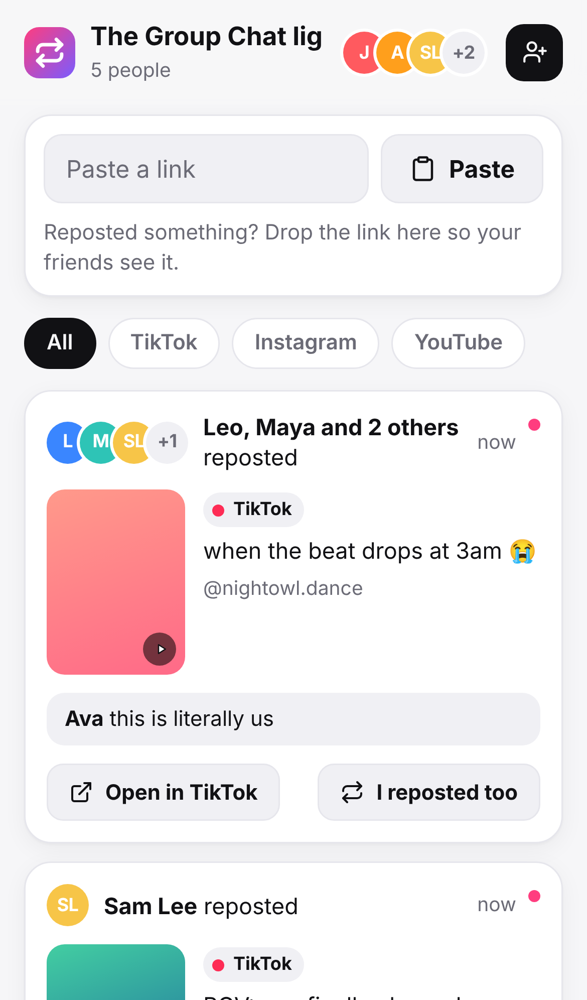
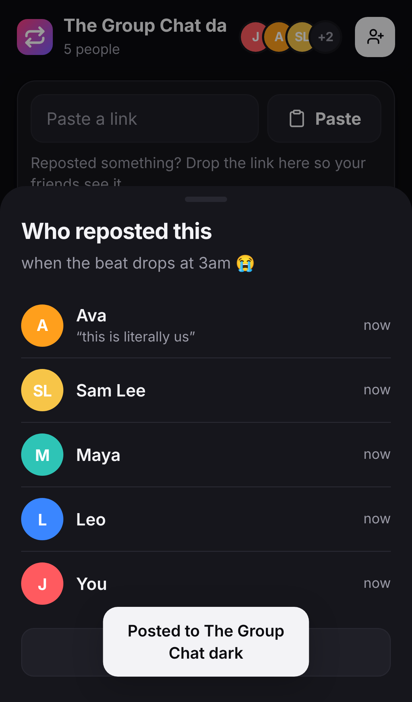

# Reposted

A private feed for your friend group that shows **who reposted what** on TikTok, Instagram, YouTube, X, Threads, Snapchat, Reddit and more.

<p> </p>

- **"Who reposted this?"** Every post shows which friends reposted it ("Ava, Sam and 2 others reposted"). Paste a link and it tells you right away if someone in the group already reposted it.
- **Smart link matching.** Short links, share links and tracking junk are cleaned up, so `vm.tiktok.com/ZM…`, `tiktok.com/@user/video/123?is_from_webapp=1` and friends all count as the same video.
- **Previews.** Titles, creators and thumbnails are fetched automatically, and thumbnails are saved so they don't break when the platform's links expire.
- **Live updates.** New reposts show up instantly for everyone, no refresh needed.
- **Share sheet on Android.** Install the app, then Share → Reposted from TikTok/Instagram/YouTube and it posts in one tap. On iPhone: Copy link → Paste.
- **No social logins.** Nobody hands over their TikTok or Instagram password. Join with a 6-character group code and a name.
- Multiple groups, filters by platform or person, notes on reposts, dark mode, installable to your home screen.

## Why it doesn't "inject" into TikTok or Instagram

Neither app offers any way for outside apps to see reposts. The "who reposted" apps you find online either ask for your password (a common way accounts get stolen), scrape the site and break constantly, or use modded app builds that get accounts banned. Reposted works because it doesn't depend on any of that: your group shares links into the app, which takes about two taps.

## Run it

You need [Node.js](https://nodejs.org) 18 or newer. There are no dependencies to install.

```bash
npm start          # http://localhost:3000
npm test           # run the tests
```

Data is stored in `data/` (or wherever `DATA_DIR` points).

## Put it online for your friends

Your friends need to reach it from their phones, so host it somewhere with **persistent storage** (otherwise the group's data resets when the server restarts):

- **Render:** create a new Blueprint from this repo and it picks up `render.yaml` (web service plus a 1 GB disk).
- **Railway / Fly.io / any Docker host:** use the `Dockerfile` and mount a volume at `/data`.

It needs HTTPS (all of those hosts provide it) for the install and share-sheet features to work.

## Project layout

```
server.js          HTTP server + API (no dependencies)
lib/links.js       link detection and normalization per platform
lib/preview.js     short-link resolving, previews, thumbnail caching
lib/store.js       JSON-file storage
public/            the web app (HTML/CSS/JS, manifest, service worker, icons)
test/              node:test suites
```
